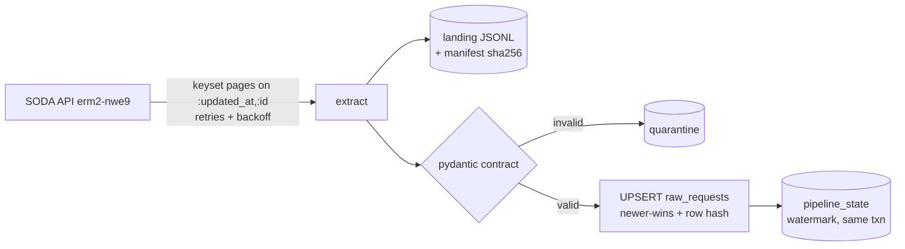

# NYC 311 SLA Watch

Daily, bias-aware monitoring of how quickly NYC agencies close 311 service requests,
by agency × complaint type × borough × community board.

> **Status:** in progress. Milestone M1 (incremental extract and idempotent load) is done.
> See [docs/STATUS.md](docs/STATUS.md). The full README, with an example report, ships in M5.

## Why

NYC Open Data publishes every 311 request, but there's no simple daily answer to
*"which complaint types in my district are closing more slowly than usual?"*. This
project builds a tested pipeline that produces that answer for community boards,
council staff and reporters.

## Architecture (current)



Design and trade-offs: [docs/DESIGN.md](docs/DESIGN.md). Review outcomes:
[docs/DECISIONS.md](docs/DECISIONS.md).

## Quick start

```bash
git clone https://github.com/Asal2/nyc311-sla-watch && cd nyc311-sla-watch
make setup          # Python 3.13; installs pinned deps
make test           # unit + integration; no network needed
make check          # lint + mypy + all tests (what CI runs)

# live run (needs internet; SODA_APP_TOKEN optional)
SLA_WINDOW_DAYS=7 make run
make status         # rows, quarantine, watermark, content checksum
python -m sla_watch.cli backfill --start 2026-10-01 --end 2026-11-01
```

## Configuration

| Env var | Default | Meaning |
|---|---|---|
| `SLA_DB_PATH` | `data/warehouse.db` | SQLite warehouse |
| `SLA_WINDOW_DAYS` | `90` | Rolling window on `created_date` (NY local) |
| `SLA_OVERLAP_HOURS` | `2` | Re-read overlap behind the watermark |
| `SODA_APP_TOKEN` | — | Optional free Socrata app token (never logged) |
